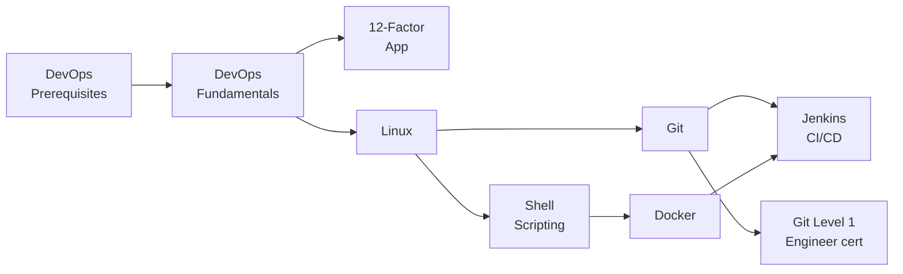

<div align="center">

# 🧪 Lab — DevOps Engineering Journal

**Hands-on DevOps practice: real sysadmin scenarios, production-minded Bash scripts, and a verified learning path.**


</div>

---

## 👋 About

I'm **Marco Antonio Amoroso**, working toward a **DevOps Engineer** role. This repo is my public lab notebook: every concept I learn gets turned into something practical — a script I actually use, or a reproducible runbook for a realistic ops task.

Every runbook does three things:

1. **States the objective**, written like a ticket from a team.
2. **Walks through the procedure** step by step, with the exact commands and checks.
3. **Includes a cleanup / rollback section** so the system goes back to a clean state.

> I document *how* and *why*, not just *what*. Rollback steps are part of every task, because changes in production have to be reversible.

---

## 🧰 Skills Demonstrated

| Area | What's shown in this repo |
| --- | --- |
| **Linux administration** | User and group lifecycle (`useradd`, `usermod`, `groupadd`, `chage`), service accounts, custom UIDs and home directories, account expiry |
| **Security hardening** | Disabling SSH root login (`sshd_config`, `sshd_config.d/`), `nologin` shells for automation accounts, least-privilege group access |
| **Networking & firewalls** | Removing UFW chains from `iptables` / `ip6tables` safely to resolve **UFW ↔ Docker** conflicts |
| **Bash scripting** | `case` logic, functions, process inspection (`pgrep`), `awk` text processing, safe array handling, shellcheck-clean scripts |
| **Git internals & hosting** | Self-hosted **bare repositories** shared over SSH with setgid directories (`chmod 2770`) and `--shared=group` |
| **File operations** | Finding and moving files by owner/UID with `find -user … -exec cp --parents` (copy and verify before deleting) |
| **Remote ops** | All tasks done over SSH on remote hosts, the way real infrastructure work happens |
| **DevOps foundations** | DevOps principles, the 12-Factor App, CI/CD with Jenkins, containers with Docker *(certified, see below)* |

---

## ⭐ Featured Work

### 🔧 Scripts — [`Linux/scripts`](Linux/scripts)

| Script | Problem it solves | Techniques |
| --- | --- | --- |
| [`remove-ufw-rules.sh`](Linux/scripts/remove-ufw-rules.sh) | UFW and Docker don't work well together. The script removes **only** UFW-owned jump rules from `INPUT`/`FORWARD`/`OUTPUT`, then flushes and deletes the `ufw-*`/`ufw6-*` chains, for IPv4 or IPv6. | `iptables -S` parsing with `awk`, converting `-A` rules into `-D`, `read -a` for safe argument splitting |
| [`ssh-agent-key.sh`](Linux/scripts/ssh-agent-key.sh) | Stops duplicate or stale `ssh-agent` processes on login: reuses, kills or starts agents as needed and loads the key. Handles DevPod sessions. Sourced from `.bashrc`. | `pgrep`, `case` on process lists, reusable functions, environment sourcing |

### 📓 Runbooks — real-world scenarios

| # | Scenario | Area | Key commands |
| :-: | --- | --- | --- |
| 1 | [Disable SSH root login](Linux/workbook/secure-ssh-root-login-no.md) | 🔐 Security | `PermitRootLogin no`, `systemctl restart ssh` |
| 2 | [Group + users for shared administration](Linux/workbook/group-user-creation-for-administration.md) | 👥 IAM | `groupadd`, `usermod -aG`, `id` |
| 3 | [Temporary account with expiration date](Linux/workbook/create-user-account-with-expiration-date.md) | 👥 IAM | `useradd -e`, `chage -l` |
| 4 | [Non-interactive account for automation](Linux/workbook/create-user-no-interactive-shell.md) | 🤖 Automation | `useradd -s /usr/sbin/nologin` |
| 5 | [Service account without a home directory](Linux/workbook/create-user-service-account-no-home-directory.md) | ⚙️ Services | `useradd -M` |
| 6 | [Application user with custom UID & home](Linux/workbook/specific-user-account-application.md) | ⚙️ Services | `useradd -u -d` |
| 7 | [Recover files a user misplaced in an app folder](Linux/workbook/copy-misplace-files-from-a-specific-user.md) | 📁 Files | `find -user -exec cp --parents` |
| 8 | [Self-hosted Git server with a shared bare repo](Git/workbook/git-installation-and-bare-repo-creation.md) | 🌿 Git | `git init --bare --shared=group`, `chmod 2770` |

---

## 🎓 Certifications (KodeKloud)

All certificates are stored as PDFs in this repo and can be checked by their certificate ID.

| Date | Certificate | Type | File |
| --- | --- | --- | --- |
| Oct 07, 2026 | 12 Factor App | Course Completion | [PDF](12-Factor-app-Kodekloud.pdf) |
| Oct 12, 2026 | DevOps Pre-Requisite Course | Course Completion | [PDF](DevOps-Prerequisites-Kodekloud.pdf) |
| Oct 12, 2026 | Fundamentals of DevOps | Course Completion | [PDF](DevOps-Fundamentals-Kodekloud.pdf) |
| Oct 18, 2026 | Learning Linux Basics Course & Labs | Course Completion | [PDF](Linux/Linux-Beginner-Kodekloud.pdf) |
| Oct 20, 2026 | Git for Beginners | Course Completion | [PDF](Git/Git-Beginners-Kodekloud.pdf) |
| Oct 22, 2026 | Shell Scripts for Beginners | Course Completion | [PDF](Linux/Shell-Scripts-Beginners-Kodekloud.pdf) |
| Oct 26, 2026 | Jenkins for Beginners | Course Completion | [PDF](CI-CD/Jenkins/Jenkins-Beginners-Kodekloud.pdf) |
| Oct 29, 2026 | Docker Training Course for the Absolute Beginner | Course Completion | [PDF](Linux/Containers/Docker-Beginners-Kodekloud.pdf) |
| Nov 07, 2026 | **Git — Level 1** (tasks + final test) | 🏅 Engineer Topic Completion | [PDF](Git/Git1_Certificate.pdf) |

---

## 🗺️ Learning Path



---

## 📂 Repository Structure

```text
lab/
├── Linux/
│   ├── scripts/        # Bash scripts I use day to day (shellcheck-clean, #!/bin/bash)
│   ├── workbook/       # Runbooks: objective → procedure → cleanup
│   └── Containers/     # Docker certification
├── Git/
│   └── workbook/       # Self-hosted Git server runbook
├── CI-CD/
│   └── Jenkins/        # Jenkins certification
└── *.pdf               # DevOps foundations certificates
```

### Runbook template

Every runbook follows the same layout, so they're consistent and quick to scan:

```markdown
# Procedure
**Objective:** <the task, written like a team request>
1. Connect to the host
2. Perform the change
3. Verify the result

# Cleanup
1. Undo every step so the system is back to a clean state

#tags #for #discoverability
```

---

## 📈 What's Next

This lab grows with each course and challenge. Areas it's heading into: deeper **CI/CD pipelines with Jenkins**, **containerized workloads with Docker**, and more automation scripts.

⭐ **Star the repo** to follow along. Feedback and suggestions are welcome through [Issues](https://github.com/itsmamoroso/lab/issues).

<div align="center">

**Built in public by [@itsmamoroso](https://github.com/itsmamoroso)**

</div>
